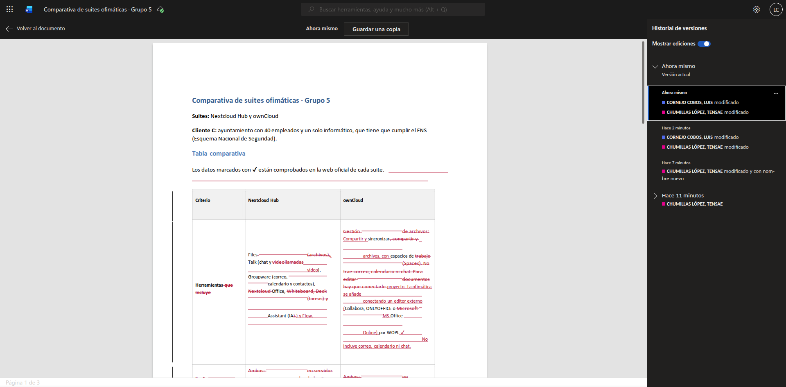

# UD4.1b · Comparativa de suites ofimáticas — Grupo 5

**Suites:** Nextcloud Hub frente a ownCloud
**Cliente C:** ayuntamiento de 40 empleados, con un solo informático, que debe cumplir el **ENS** (Esquema Nacional de Seguridad, RD 311/2022).

Documento del grupo: [`archivos/Comparativa_Grupo5.docx`](archivos/Comparativa_Grupo5.docx)

> Los datos marcados con ✔ los hemos comprobado en la web o la documentación oficial de cada producto (enlaces en las [fuentes](#fuentes)).

---

## 1. Tabla comparativa

| Criterio | Nextcloud Hub | ownCloud |
|---|---|---|
| **Herramientas que incluye** | Una plataforma completa: **Files** (archivos), **Talk** (chat y videollamadas), **Groupware** (correo, calendario y contactos), **Office** (ofimática), además de Assistant (IA) y Flow (automatización) ✔ | Se centra en **compartir y sincronizar archivos**, con espacios de proyecto y clientes de escritorio y móvil. No trae correo, calendario ni chat. La ofimática se añade conectando un editor externo (Collabora, ONLYOFFICE o Microsoft Office Online) mediante WOPI ✔ |
| **SaaS, autoalojado o ambos** | **Ambos.** Normalmente se autoaloja (servidor propio). Nextcloud vende solo el software y ofrece SaaS u *on-premise* a través de partners ✔ | Principalmente **autoalojado** (Infinite Scale se instala en un servidor propio o en una nube como Hetzner). No hemos encontrado una oferta SaaS oficial actual |
| **Licencia** | **Software libre, GNU AGPLv3** (100 % *copyleft*, sin *open core*) ✔. Suscripción **Enterprise** opcional para tener soporte (desde 42 €/usuario/año) ✔ | **Infinite Scale:** el código fuente es **Apache 2.0** ✔, pero los binarios oficiales de ownCloud GmbH van con una licencia EULA *freemium* que no es libre ✔. La versión antigua, ownCloud Classic, está en migración hacia Infinite Scale |
| **¿Se edita a la vez?** | **Sí.** Nextcloud Office (basado en Euro-Office, con Collabora Online como alternativa) permite editar en tiempo real textos, hojas de cálculo y presentaciones ✔ | **Sí, pero no por sí solo:** hace falta conectar un servidor de documentos (Collabora u ONLYOFFICE). Si se usa Microsoft Office, hay que tener Office Online Server o una suscripción a Microsoft 365 ✔ |
| **Dónde se guardan los datos** | En el **servidor que elija el cliente**: su propio CPD o un proveedor de su país. Así el ayuntamiento controla dónde están los datos | Igual que Nextcloud: en el **servidor propio** del cliente o en el proveedor de alojamiento que este contrate |
| **Punto fuerte** | Es una suite **completa y soberana** que sustituye a Microsoft 365 o Google Workspace, y es la nube autoalojada más usada por administraciones públicas (por ejemplo, ITZBund, el proveedor de TI del gobierno federal alemán) ✔ | Es **ligero y rápido** (Infinite Scale está escrito en Go y no necesita base de datos) y muy bueno en lo suyo: **compartir archivos** de forma segura |
| **Punto débil** | Al tener **tantos módulos**, cuesta más mantenerlo y actualizarlo: es mucho trabajo para un solo informático si no hay soporte contratado | Le **faltan herramientas** (correo, calendario, chat) y ha habido **incertidumbre**: lo compró Kiteworks a finales de 2023 ✔ y en 2025 parte del equipo creó una bifurcación (OpenCloud) ✔ |

**Dato de contexto:** Nextcloud nació en 2016 como bifurcación de ownCloud, creada por su propio fundador. Por eso las dos suites se parecen tanto en su base.

---

## 2. Recomendación para el cliente C (ayuntamiento)

> Recomendamos **Nextcloud Hub** con suscripción **Enterprise**, alojado en el CPD municipal o en un proveedor español que ya cumpla el ENS.
> Con una sola plataforma cubre archivos, correo, calendario, videollamadas y edición simultánea, sin pagar licencias por cada aplicación.
> El ENS se certifica sobre el **sistema** del ayuntamiento y no sobre el producto. Como los datos se quedan en España y bajo control municipal, aplicar las medidas del ENS es más sencillo.
> Con un solo informático, el soporte Enterprise (o el proveedor que lo aloje) asume las actualizaciones y los parches de seguridad.
> ownCloud solo cubre archivos: habría que integrar y mantener aparte la ofimática, el correo y el chat.

---

## 3. Historial de versiones del documento

**Explicación:** la captura es el historial de versiones del documento del grupo en **Word web (Microsoft 365)**, con la opción *Mostrar ediciones* activada: lo que se añade sale **subrayado** y lo que se borra sale **tachado**.

- **Hace 11 minutos:** Tensae Chumillas López crea la primera versión del documento.
- **Hace 7 minutos:** Tensae lo modifica y le pone el nombre definitivo, *Comparativa de suites ofimáticas · Grupo 5*.
- **Hace 2 minutos y ahora mismo:** en las dos versiones aparecen cambios de **Luis Cornejo Cobos** (azul) y de **Tensae Chumillas López** (rosa). En la tabla se ve cómo reescribimos y corregimos las celdas de *Herramientas*: textos tachados sustituidos por otros subrayados.

Cada autor tiene su color y Word junta los cambios de los dos en las mismas versiones. Eso demuestra que **trabajamos a la vez sobre un único documento en la nube**, sin enviarnos copias por correo. Además, el historial permite volver a cualquier versión anterior (*Guardar una copia*).

---

## Fuentes

- Nextcloud Hub: <https://nextcloud.com/hub/> · <https://nextcloud.com/blog/nextcloud-hub-european-microsoft-365-google-workspace-alternative/>
- Licencia AGPLv3 de Nextcloud: <https://nextcloud.com/faq/>
- Precios de Nextcloud Enterprise: <https://nextcloud.com/pricing/>
- Nextcloud Office (Euro-Office), edición en tiempo real: <https://docs.nextcloud.com/server/stable/admin_manual/office/euro-office/index.html>
- Nextcloud en el sector público: <https://nextcloud.com/government/> · <https://nextcloud.com/blog/digital-sovereignty-for-governments-with-nextcloud-enterprise/>
- Licencia de ownCloud Infinite Scale: <https://doc.owncloud.com/ocis/9.0/developer/license.html>
- ownCloud y WOPI (Collabora, ONLYOFFICE y Microsoft Office): <https://doc.owncloud.com/ocis/8.3/admin/deployment/wopi/wopi.html>
- ownCloud pasa a formar parte de Kiteworks: <https://owncloud.com/blogs/owncloud-becomes-part-of-kiteworks/>
- Bifurcaciones de ownCloud: <https://owncloud.com/blogs/what-happens-when-you-fork-twice-get-acquired-and-keep-shipping-anyway/>
- ENS, Real Decreto 311/2022: <https://www.boe.es/buscar/pdf/2022/BOE-A-2022-7191-consolidado.pdf>
