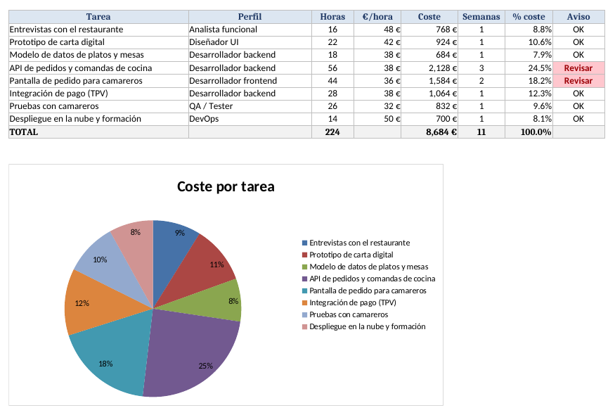

# UD4.2 · Trabajo cooperativo con suites SaaS · Pareja BETA (Microsoft 365)

**Cliente:** pareja Alpha (Google Workspace) · **Encargo:** aplicación de pedidos para un restaurante · **Suite de Beta:** Microsoft 365 (Excel Online / Excel de escritorio)

> Estado: BORRADOR (ronda 1). Los apartados con `📸 Pendiente` se completan con las capturas reales del alumno.

## Estructura de la entrega

```
UD4/UD4.2_Alpha-Beta/
├── README.md
├── img/
└── archivos/Costes_y_plazos.xlsx   ← archivo real, no una captura
```

Vista previa (generada fuera de Excel, solo orientativa; las evidencias son las capturas del alumno):



---

## B1 · Hoja con datos propios y cálculos correctos (3 pt)

**Contexto.** Alpha nos encarga presupuestar una aplicación de pedidos para un restaurante. Hemos descompuesto el trabajo en 8 tareas con datos propios (distintas del ejemplo del enunciado): perfiles de analista funcional, backend, frontend, diseñador UI, QA y DevOps, con tarifas de 32 a 50 €/h. La hoja **Tarifas** guarda los precios y la hoja **Costes** calcula todo lo demás con fórmulas.


> 📸 Pendiente: hoja **Tarifas** completa (6 perfiles con su precio/hora), con la pestaña visible.


> 📸 Pendiente: hoja **Costes** con las 8 tareas y la fila TOTAL a la vista, mostrando los valores calculados.


> 📸 Pendiente: dos capturas (o un montaje) con la barra de fórmulas: celda **D2** (`=BUSCARV(B2;Tarifas!$A$2:$B$7;2;FALSO)`) y celda **G2** (`=E2/$E$10`).

**Deducción.**
- La columna D no se escribe: `BUSCARV` busca el perfil de la columna B en Tarifas. Si mañana sube el precio del backend, se cambia **una sola celda** en Tarifas y se recalculan todas las tareas de ese perfil.
- El rango `Tarifas!$A$2:$B$7` es absoluto para que no se desplace al copiar la fórmula hacia abajo; igual `$E$10` en la columna G: cada porcentaje se divide siempre entre el total, no entre la fila de al lado (sin el `$` saldría un `#¡DIV/0!` o porcentajes sin sentido al copiar).
- Resultados: **224 horas, 8.684 € y 11 semanas**; la columna G suma **100 %**, lo que confirma que las referencias están bien. Comprobación manual: 768 + 924 + 684 + 2.128 + 1.584 + 1.064 + 832 + 700 = 8.684 €.
- La columna H marca "Revisar" en 2 tareas (API de pedidos, 56 h; pantalla de camareros, 44 h) porque superan 40 horas: son las que hay que justificar al cliente.

---

## B2 · Lista desplegable de perfiles (1,5 pt)

**Contexto.** Si cada persona escribe el perfil a mano ("Backend", "backend ", "Programador"...), `BUSCARV` falla y el precio desaparece. Para evitarlo hemos aplicado a B2:B9 una **validación de datos** de tipo Lista cuyo origen es `=Tarifas!$A$2:$A$7`.


> 📸 Pendiente: celda de la columna B con el desplegable abierto mostrando los 6 perfiles.


> 📸 Pendiente: cuadro **Datos → Validación de datos** con Permitir: Lista y Origen `=Tarifas!$A$2:$A$7`.


> 📸 Pendiente: intento de escribir un perfil que no existe (p. ej. "Becario") y el mensaje de error "Perfil no válido".

**Deducción.** La lista no está escrita a mano en la validación: apunta a Tarifas. Así hay **una única fuente de verdad**: si se añade un perfil nuevo en Tarifas (y se amplía el rango), aparece en el desplegable. Además Excel rechaza valores fuera de la lista, de modo que la columna D nunca devuelve `#N/D` por una errata. Es control de calidad del dato en origen, no corrección posterior.

---

## B3 · Hoja protegida salvo A, B, C y F (1,5 pt)

**Contexto.** La hoja la usará también el cliente (Alpha) para ajustar horas, y no queremos que rompa las fórmulas. Hemos desbloqueado solo A, B, C y F de las filas de datos (Formato de celdas → Protección → desmarcar *Bloqueada*) y luego **Revisar → Proteger hoja** (contraseña: `asir`, documentada solo para esta práctica).


> 📸 Pendiente: **Formato de celdas → Protección** con *Bloqueada* desmarcado en un rango A2:C9 / F2:F9 (basta una celda de muestra).


> 📸 Pendiente: intentar escribir en **E5** (o D5, G5, H5) con la hoja protegida y el aviso de Excel "la celda está protegida".


> 📸 Pendiente: cambiar las **horas de C5** (p. ej. de 56 a 50) y mostrar cómo se recalculan E5, G, H y el TOTAL.

**Deducción.** Excel no deja tocar la columna E (ni D, G, H ni el total), pero sí las horas, y el coste se recalcula solo: el cliente puede ajustar los datos de entrada sin poder estropear las fórmulas. El bloqueo de celdas no hace nada hasta que se activa la protección de hoja: son dos pasos. La contraseña sencilla impide el descuido, no un ataque: es un control de integridad, no de confidencialidad.

---

## B4 · Gráfico y su lectura (1,5 pt)

**Contexto.** Para ver de un vistazo dónde se va el dinero hemos insertado un **gráfico circular** con el coste (columna E) por tarea (columna A), con porcentajes como etiquetas.


> 📸 Pendiente: gráfico circular completo, con título "Coste por tarea", leyenda y etiquetas de porcentaje, junto a la tabla.

**Lectura del gráfico.**
- La porción mayor es la **API de pedidos y comandas de cocina: 2.128 € (24,5 %)**, casi una cuarta parte del presupuesto y 3 de las 11 semanas. Le sigue la **pantalla de pedido para camareros: 1.584 € (18,2 %)**.
- Esas dos son justo las que la columna H marca "Revisar" (>40 h) y juntas suman **3.712 € (42,7 %)**: casi la mitad del coste está en dos tareas.
- Las tareas de análisis, datos, pruebas y despliegue pesan entre 8 y 12 % cada una; no son el riesgo.
- **Implicación:** el presupuesto es sensible a cualquier cambio de alcance en la API y la pantalla del camarero. Si Alpha añade requisitos (p. ej. pedidos desde móvil del cliente), ahí se dispararán el coste y el plazo. Conviene pactar en la reunión el alcance exacto de esas dos tareas, y negociar o dividir en fases (primero un mínimo viable) antes de comprometer las 11 semanas.
- El gráfico se actualiza con la tabla: si cambiamos horas, cambia el reparto.

---

## B5 · Comentario con mención y sugerencia en el acta (1,5 pt)

*(Parte de la ronda 2: se redactará al conocer `Requisitos.docx` y `Acuerdo.docx` de Alpha.)*

**Contexto.** (pendiente) Alpha nos comparte los requisitos del software; hacemos de consultores y dejamos un comentario con **@mención** para que le llegue el aviso.


> 📸 Pendiente: comentario con @mención en el documento de Alpha (Word/Docs según la suite desde la que se abra), con la respuesta o resolución de Alpha.


> 📸 Pendiente: cambio hecho en **modo sugerencia** sobre uno de los 3 acuerdos del acta, y la decisión de Alpha (aceptar/rechazar con comentario).

**Deducción.** (pendiente de ronda 2)

---

## B6 · Prueba de permisos (1 pt)

**Contexto.** Probamos qué ve alguien ajeno a la organización con nuestro archivo `Costes_y_plazos.xlsx` en OneDrive/SharePoint, en tres estados: compartido solo con personas concretas, "cualquiera con el enlace" y de nuevo restringido.


> 📸 Pendiente: abrir el enlace del archivo en **ventana de incógnito/InPrivate** (sin sesión) con acceso restringido: pide iniciar sesión o deniega.


> 📸 Pendiente: **Compartir → Configuración del vínculo → Cualquier persona con el vínculo**, con el permiso elegido (ver/editar) visible.


> 📸 Pendiente: el mismo enlace en incógnito, ahora abre sin iniciar sesión.


> 📸 Pendiente: configuración final restringida (solo personas concretas) y de nuevo bloqueo en incógnito.

**Deducción.** Con acceso restringido, el incógnito (que no tiene nuestra sesión) no puede entrar: el control va ligado a la identidad. Con "cualquiera con el enlace" abre sin cuenta: **el enlace funciona como contraseña**. Riesgo: si se reenvía, se publica o se indexa, cualquiera accede sin que sepamos quién; no hay trazabilidad por persona y, si el permiso es de edición, puede alterar o borrar costes (datos comerciales sensibles). Por eso se vuelve a restringir al terminar y, si hace falta enlace abierto, se pone solo lectura y con caducidad.

---

## Autoevaluación

**1. ¿Qué diferencia hay entre rol comentarista y modo sugerencia?**
El *rol* es un permiso sobre el archivo: el comentarista puede comentar pero **no modificar** el contenido. El *modo sugerencia* es una forma de trabajar de alguien que sí puede editar: sus cambios no se aplican, quedan propuestos (tachado/subrayado) hasta que el autor los acepta o rechaza. Uno limita lo que se puede hacer; el otro controla cómo entran los cambios.

**2. ¿Qué riesgo tiene "cualquiera con el enlace"?**
Que el acceso depende solo de conocer la URL: se puede reenviar o filtrar, no exige identificarse ni deja constancia de quién entra, y con permiso de edición cualquiera puede cambiar o borrar. Es una fuga de información potencial (precios, datos del cliente) y un incumplimiento de protección de datos si hay datos personales.

**3. ¿Qué haría falta para no depender de Google ni de Microsoft?**
Una alternativa propia o de código abierto autoalojada (Nextcloud + OnlyOffice/Collabora, para ficheros, edición colaborativa, calendario y formularios), con servidor, copias de seguridad, usuarios y permisos gestionados por nosotros, y formatos abiertos (ODF, CSV) para poder migrar. A cambio, asumimos mantenimiento, seguridad y disponibilidad que en SaaS lleva el proveedor.

---

## Pasos que debe hacer el alumno en Microsoft 365

- [ ] Entrar en Microsoft 365 con la cuenta del centro y comprobar acceso a Excel y OneDrive.
- [ ] Comprobar `git push` a tu repositorio de la organización.
- [ ] Subir `archivos/Costes_y_plazos.xlsx` a OneDrive y abrirlo en Excel (Online o escritorio). Comprobar que fórmulas, desplegable y gráfico funcionan (si usas Excel en inglés, las fórmulas se traducen solas).
- [ ] Capturas B1: Tarifas, Costes con total, barra de fórmulas de D2 y G2. Guardar en `img/`.
- [ ] Capturas B2: desplegable, cuadro de validación y mensaje de error.
- [ ] Capturas B3: desbloqueo, intento en celda bloqueada, cambio de horas con recálculo (contraseña de protección: `asir`; para el cuadro de desprotección: Revisar → Desproteger hoja).
- [ ] Captura B4: gráfico circular visible junto a la tabla.
- [ ] Compartir el xlsx con Alpha como **editor** (solo con su cuenta/correo) y capturar la invitación. Si Alpha no comparte lo suyo, documentar el intento con una captura.
- [ ] Ronda 2: comentario con @mención en los requisitos de Alpha y sugerencia en el acta (B5); capturas.
- [ ] Responder al formulario de Alpha (cada miembro) y capturar la confirmación.
- [ ] B6: incógnito restringido, "cualquiera con el enlace", incógnito de nuevo, volver a restringir; capturas.
- [ ] Sustituir cada `📸 Pendiente` por la captura real y completar contexto y deducción con lo que se ve de verdad (nombres, fechas, mensajes de Excel).
- [ ] `git add UD4/UD4.2_Alpha-Beta` · `git commit -m "UD4.2: evidencias Beta"` · `git push`.
